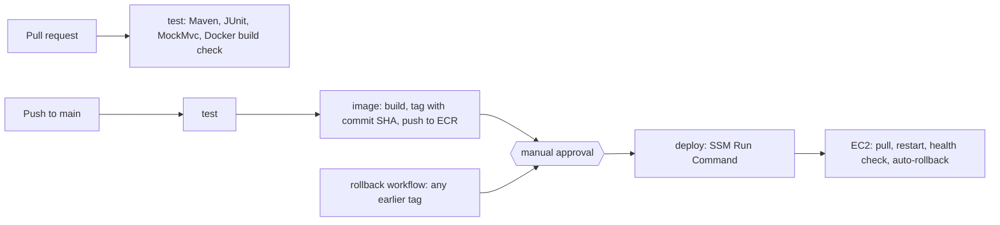
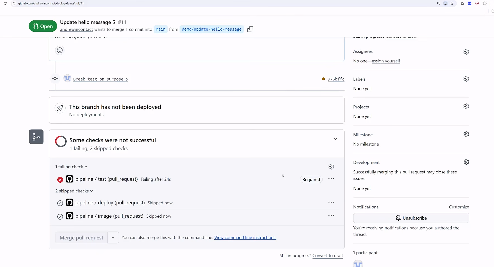
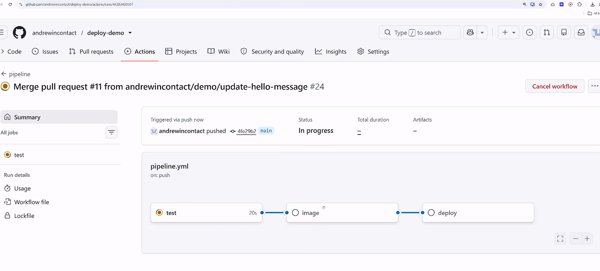
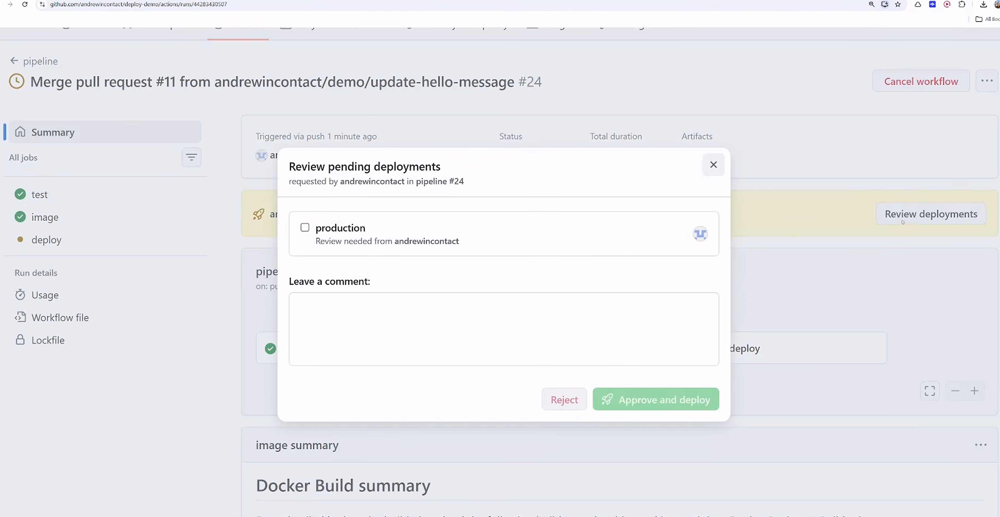
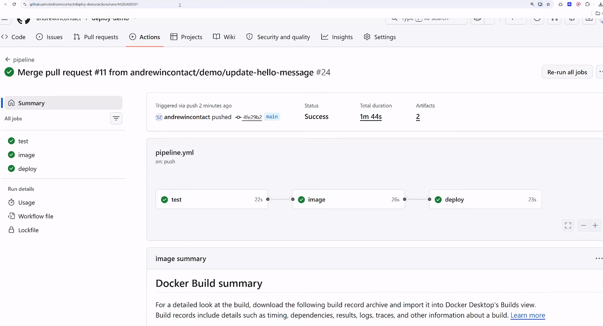
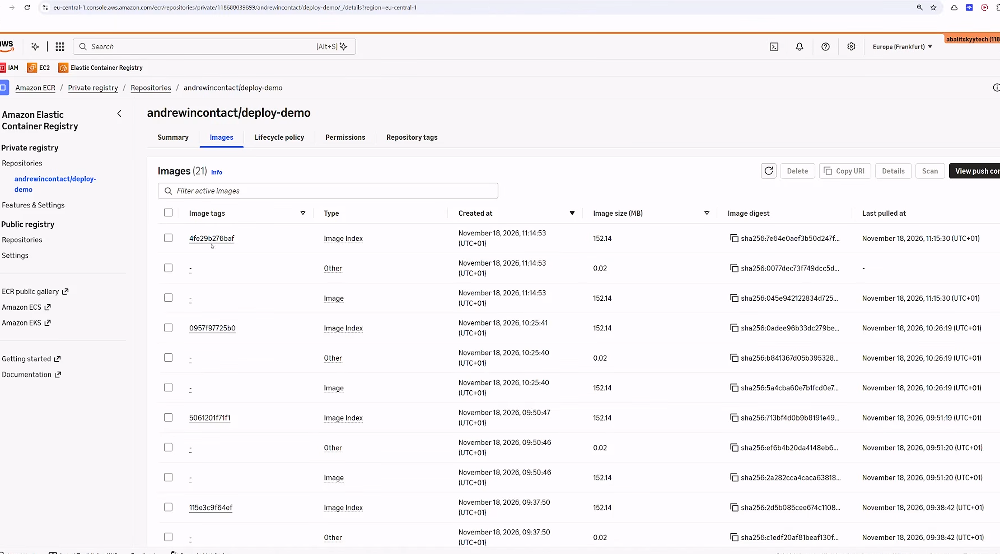
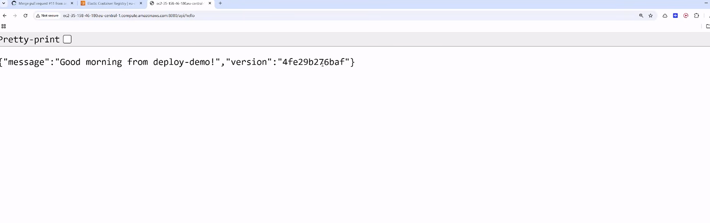

# deploy-demo

**CI/CD pipeline for a Spring Boot service: from a pull request to a running Docker container on AWS EC2.**

Java 25, Spring Boot, Maven, JUnit, MockMvc, Docker, Docker Compose, GitHub Actions, Amazon ECR, EC2, AWS Systems Manager, IAM (OIDC)


## Pipeline



## What I implemented

**Continuous integration**
- Set up a GitHub Actions pipeline: test → image → deploy
- Wrote JUnit and MockMvc tests that run on every pull request
- Added a Docker build check on pull requests
- Required a passing `test` check before merging to `main`

**Docker and Amazon ECR**
- Built a Docker image on a JRE base
- Put the same JAR that passed the tests into the image
- Pushed images to Amazon ECR

**Security**
- Used OIDC instead of stored AWS keys
- Limited IAM permissions to only what the pipeline needs
- Deployed without SSH (no open port 22)

**Deployment**
- Added manual approval before every deployment
- Deployed to EC2 through AWS Systems Manager
- Wrote a deploy script that restarts the container and checks its health
- Showed the deployed image tag in each run's summary

**Rollback and maintenance**
- Added automatic rollback when the health check fails
- Created a manual rollback workflow for any earlier image

## Screenshots








## Demo video

[Watch the demo](https://www.youtube.com/watch?v=yyBP_bz-9qU): failing test blocks the merge → fix and merge → approve the deployment → new version live → rollback to the previous image.

## Decisions

* **OIDC instead of AWS keys:** no need long-lived secret
* **SSM instead of SSH:** every command is checked by IAM and logged in AWS
* **Copying the tested JAR instead of building it again in Docker:**
* **Immutable commit tags:** a tag always means the same image, so a rollback goes back to exactly what ran before
* **One EC2 instance with Docker Compose:** simple and cheap for a demo

## Limitations and next steps

- **One server:** if it goes down, the app goes down, and each deploy causes a few seconds of downtime. Next: several servers behind a load balancer
- **No HTTPS:** next: a load balancer with TLS
- **AWS set up by hand:** next: Terraform
- **No monitoring:** next: CloudWatch alarms
- **Kubernetes:** my next project, with zero-downtime updates

## Run it locally

```bash
./mvnw -B verify
docker build -t deploy-demo:local .
docker run --rm -p 8080:8080 deploy-demo:local
curl http://localhost:8080/api/hello          # {"message":"…","version":"local"}
curl http://localhost:8080/actuator/health    # {"status":"UP"}
```

## AWS setup (one-time, eu-central-1)

1. **ECR:** repository `deploy-demo` with immutable tags
2. **IAM:** GitHub as an OIDC provider, and a role only this repo can use
3. **EC2:** Ubuntu server with SSM access and no SSH port
4. **GitHub:** `production` environment with approval, and the secrets `AWS_ROLE_ARN`, `INSTANCE_ID`, `APP_HOST`

## Author

Andriy Balitskyy · [LinkedIn](https://www.linkedin.com/in/andriy-balitskyy-06420a245/)


